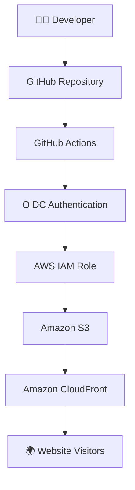

# ☁️ AWS Infrastructure as Code & CI/CD Pipeline

\<div align="center">

# AWS DevOps Demo

### Automating AWS Infrastructure and Website Deployment with Terraform & GitHub Actions

**Learn. Build. Automate. Deploy**

\<br/>

**A practical AWS DevOps project for the AWS Student Community Day Pre-Event Session 3.**

\</div>

---

## 📌 About the Project

This project demonstrates how to provision cloud infrastructure using **Infrastructure as Code (IaC)** and automate application deployment using a **CI/CD pipeline**.

We build a static website, provision its AWS infrastructure with Terraform, and configure GitHub Actions to automate deployments whenever changes are pushed to the repository.

The project also demonstrates secure authentication between GitHub Actions and AWS using OpenID Connect (OIDC).

## 🛠️ Technology Stack

| Technology | Purpose                          |
| ---------- | -------------------------------- |
|            | Cloud infrastructure             |
|            | Infrastructure as Code           |
|            | Website storage                  |
|            | Content delivery                 |
|            | CI/CD automation                 |
|            | Secure AWS authentication        |
|            | Infrastructure security scanning |
|            | Website development              |
|            | Version control                  |

## 🏗️ Architecture



### How it works

1. A developer updates the website code.
2. Changes are pushed to GitHub.
3. GitHub Actions starts the deployment workflow.
4. GitHub authenticates with AWS using OIDC.
5. The updated website is uploaded to Amazon S3.
6. CloudFront cache is invalidated.
7. Visitors receive the updated website.

## 🎯 Project Objectives

- Understand Infrastructure as Code.
- Provision AWS infrastructure using Terraform.
- Host a static website securely on Amazon S3.
- Distribute website content using CloudFront.
- Implement CI/CD using GitHub Actions.
- Establish secure AWS authentication using OIDC.
- Introduce DevSecOps through infrastructure security scanning.

## 📂 Project Structure

```text
aws-devops-demo/
│
├── .github/
│   └── workflows/
│       └── deploy.yml
│
├── app/
│
├── terraform/
│   ├── main.tf
│   ├── providers.tf
│   ├── variables.tf
│   ├── outputs.tf
│   ├── website.tf
│   ├── cloudfront.tf
│   └── .terraform.lock.hcl
│
├── index.html
├── .gitignore
└── Readme.MD
```

## ⚙️ Prerequisites

Before starting, install the following:

- [AWS Account](https://aws.amazon.com/)
- [Terraform](https://developer.hashicorp.com/terraform/install)
- [AWS CLI](https://docs.aws.amazon.com/cli/latest/userguide/getting-started-install.html)
- [Git](https://git-scm.com/downloads)
- [Visual Studio Code](https://code.visualstudio.com/)
- [GitHub Account](https://github.com/)

Verify your installations:

```bash
terraform version
aws --version
git --version
```

## 🚀 Getting Started

### 1. Clone the repository

```bash
git clone https://github.com/paulaali/aws-devops-demo-CI-CD.git
```

Navigate into the project:

```bash
cd aws-devops-demo-CI-CD
```

### 2. Configure AWS

Configure your AWS CLI credentials:

```bash
aws configure
```

Use the AWS region:

```text
us-east-1
```

Verify your identity:

```bash
aws sts get-caller-identity
```

**Security reminder:** Never commit AWS credentials or secret keys to GitHub.

### 3. Initialize Terraform

Navigate to the Terraform directory:

```bash
cd terraform
```

Initialize the working directory:

```bash
terraform init
```

Format the configuration:

```bash
terraform fmt
```

Validate the configuration:

```bash
terraform validate
```

### 4. Review and deploy infrastructure

Preview the changes:

```bash
terraform plan
```

Deploy:

```bash
terraform apply
```

Review the proposed changes and confirm when prompted.

### 5. Retrieve the website URL

```bash
terraform output cloudfront_url
```

Open the returned CloudFront URL in your browser.

## 🔄 CI/CD Pipeline

The GitHub Actions workflow is located at:

```text
.github/workflows/deploy.yml
```

The workflow automates the following:

| Stage              | Action                                    |
| ------------------ | ----------------------------------------- |
| Checkout           | Retrieves the repository code             |
| Authentication     | Connects GitHub Actions to AWS using OIDC |
| Deployment         | Uploads the website to S3                 |
| Cache invalidation | Refreshes CloudFront content              |

### 🔐 AWS OIDC Authentication

OpenID Connect (OIDC) allows GitHub Actions to authenticate with AWS without storing long-lived AWS access keys in GitHub.

The workflow obtains temporary credentials through an IAM role with restricted permissions.

Required GitHub repository secret:

```text
AWS_ROLE_ARN
```

The IAM role should trust only the intended GitHub repository and branch.

## 🧪 Test the CI/CD Pipeline

Make a small change to `index.html`.

For example, update the website heading.

Then run:

```bash
git add index.html
git commit -m "Update website content"
git push origin main
```

Open the **Actions** tab in GitHub to monitor the workflow.

Once deployment succeeds, refresh your CloudFront website URL to see the changes.

## 🛡️ Security Practices

This project incorporates the following security measures:

- S3 Block Public Access.
- S3 server-side encryption.
- S3 bucket versioning.
- CloudFront Origin Access Control.
- Restricted S3 bucket policy.
- IAM least-privilege permissions.
- OIDC authentication.
- Terraform security scanning with Checkov (planned integration).

## 🧹 Cleanup

To avoid unnecessary AWS charges, remove the resources when the demonstration is complete.

Before running `terraform destroy`, empty the S3 bucket, including object versions and delete markers, because versioning is enabled and `force_destroy` is disabled.

Then run:

```bash
terraform destroy
```

Review the proposed deletions before confirming.

## 📚 Learning Resources

- [AWS Documentation](https://docs.aws.amazon.com/)
- [Terraform Documentation](https://developer.hashicorp.com/terraform/docs)
- [GitHub Actions Documentation](https://docs.github.com/en/actions)
- [AWS IAM OIDC Documentation](https://docs.aws.amazon.com/IAM/latest/UserGuide/id_roles_providers_create_oidc.html)
- [Checkov Documentation](https://www.checkov.io/)

---

\<div align="center">

### ☁️ Learn. Build. Automate. Deploy.

**AWS Student Community Day | Pre-Event Session 3**

Built for learning, experimentation and practical cloud engineering.

\</div>
