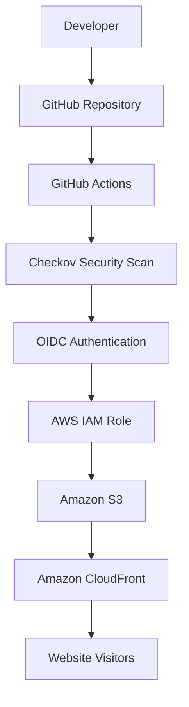

# AWS Infrastructure as Code & CI/CD Pipeline

## AWS DevOps Demo

**Automating AWS Infrastructure and Website Deployment with Terraform & GitHub Actions**

**Learn. Build. Automate. Deploy.**

*A practical AWS DevOps project for the AWS Student Community Day Pre-Event Session 3.*

---

## About the Project

This project demonstrates how to provision cloud infrastructure using **Infrastructure as Code (IaC)** and automate application deployment through a **CI/CD pipeline**.

We build a static website, provision its AWS infrastructure using Terraform, and configure GitHub Actions to automate deployments whenever changes are pushed to the repository.

The project also demonstrates secure authentication between GitHub Actions and AWS using OpenID Connect (OIDC), alongside infrastructure security scanning with Checkov.

## Technology Stack

| Technology | Purpose |
|---|---|
|  | Cloud infrastructure |
|  | Infrastructure as Code |
|  | Website storage |
|  | Content delivery |
|  | CI/CD automation |
|  | Secure AWS authentication |
|  | Terraform security scanning |
|  | Website development |
|  | Version control |

## Architecture

The project uses Terraform to provision the AWS infrastructure and GitHub Actions to automate security scanning and website deployment.



### How It Works

1. A developer updates the website code.
2. Changes are pushed to the GitHub repository.
3. GitHub Actions starts the workflow.
4. Checkov scans the Terraform configuration for security misconfigurations.
5. GitHub Actions authenticates with AWS using OIDC.
6. The updated website is uploaded to Amazon S3.
7. CloudFront cache is invalidated.
8. Visitors receive the updated website.

## Project Objectives

- Understand Infrastructure as Code.
- Provision AWS infrastructure using Terraform.
- Host a static website securely on Amazon S3.
- Distribute website content using CloudFront.
- Implement CI/CD using GitHub Actions.
- Establish secure AWS authentication using OIDC.
- Introduce DevSecOps through infrastructure security scanning.

## Project Structure

```text
aws-devops-demo/
│
├── .github/
│   └── workflows/
│       └── deploy.yml
│
├── terraform/
│   ├── main.tf
│   ├── providers.tf
│   ├── variables.tf
│   ├── outputs.tf
│   ├── website.tf
│   ├── cloudfront.tf
│   └── .terraform.lock.hcl
│
├── index.html
├── .gitignore
└── Readme.MD
```

## Prerequisites

Before starting, install the following:

- [AWS Account](https://aws.amazon.com/)
- [Terraform](https://developer.hashicorp.com/terraform/install)
- [AWS CLI](https://docs.aws.amazon.com/cli/latest/userguide/getting-started-install.html)
- [Git](https://git-scm.com/downloads)
- [Visual Studio Code](https://code.visualstudio.com/)
- [GitHub Account](https://github.com/)

Verify your installations:

```bash
terraform version
aws --version
git --version
```

## Getting Started

### 1. Clone the Repository

```bash
git clone https://github.com/paulaali/aws-devops-demo-CI-CD.git
```

Navigate into the project:

```bash
cd aws-devops-demo-CI-CD
```

### 2. Configure AWS

For local Terraform deployment, configure your AWS CLI credentials using an appropriate AWS authentication method.

For this demonstration:

```bash
aws configure
```

Set the AWS region to:

```text
us-east-1
```

Verify your AWS identity:

```bash
aws sts get-caller-identity
```

**Security reminder:** Never commit AWS credentials, access keys or secret keys to GitHub.

### 3. Initialize Terraform

Navigate to the Terraform directory:

```bash
cd terraform
```

Initialize the working directory:

```bash
terraform init
```

Format the configuration:

```bash
terraform fmt
```

Validate the configuration:

```bash
terraform validate
```

### 4. Review and Deploy Infrastructure

Preview the infrastructure changes:

```bash
terraform plan
```

Deploy the infrastructure:

```bash
terraform apply
```

Review the proposed changes and confirm when prompted.

### 5. Retrieve the Website URL

```bash
terraform output cloudfront_url
```

Open the returned CloudFront URL in your browser.

**Note:** The demonstration uses an account-specific S3 bucket name. When deploying your own copy, ensure the bucket name is globally unique and update the corresponding workflow configuration.

## CI/CD Pipeline

The GitHub Actions workflow is located at:

```text
.github/workflows/deploy.yml
```

The pipeline is triggered automatically when changes are pushed to the `main` branch and the configured file paths are modified. It can also be started manually using the GitHub Actions interface.

### Pipeline Stages

| Stage | Action |
|---|---|
| Checkout | Retrieves repository code |
| Security Scan | Runs Checkov against Terraform configurations |
| Authentication | Connects GitHub Actions to AWS using OIDC |
| Identity Verification | Confirms the authenticated AWS identity |
| Deployment | Uploads the website to S3 |
| Cache Invalidation | Refreshes CloudFront content |

### Infrastructure Security Scanning with Checkov

[Checkov](https://www.checkov.io/) is used to scan Terraform configurations for potential security misconfigurations.

The workflow installs Checkov and scans the Terraform directory:

```bash
pip install checkov
checkov -d terraform --soft-fail
```

The security scan runs before the deployment job.

**Important:** The current demonstration uses `--soft-fail`, which reports findings without blocking deployment. This allows the team to review and address findings before enforcing stricter security checks.

### AWS OIDC Authentication

OpenID Connect (OIDC) allows GitHub Actions to authenticate with AWS without storing long-lived AWS access keys in GitHub.

The process works as follows:

1. GitHub Actions requests an OIDC token.
2. AWS validates the token against the configured GitHub identity provider.
3. AWS checks the IAM role's trust relationship.
4. GitHub Actions assumes the IAM role and receives temporary AWS credentials.
5. The workflow uses those credentials to deploy the website.

The GitHub repository requires the following Actions secret:

```text
AWS_ROLE_ARN
```

The IAM role should trust only the intended GitHub repository and branch and have the minimum permissions required for deployment.

## Test the CI/CD Pipeline

To test automatic deployment:

1. Make a small change to `index.html`.
2. Save the file.
3. Commit and push the changes to the `main` branch.

Run:

```bash
git add index.html
git commit -m "Update website content"
git push origin main
```

Open the **Actions** tab in GitHub to monitor the workflow.

A successful run should show:

- Terraform Security Scan: Passed
- Deploy Website: Passed

Once deployment succeeds, refresh your CloudFront website URL to see the updated content.

## Security Practices

This project incorporates the following security measures:

- Amazon S3 Block Public Access.
- S3 server-side encryption.
- S3 bucket versioning.
- CloudFront Origin Access Control (OAC).
- Restricted S3 bucket policy.
- IAM least-privilege deployment permissions.
- GitHub Actions OIDC authentication.
- Temporary AWS credentials instead of long-lived GitHub access keys.
- Terraform security scanning with Checkov.

## Cleanup

To avoid unnecessary AWS charges, remove the resources when the demonstration is complete.

**Important:** S3 versioning is enabled, and `force_destroy` is disabled. Empty the bucket, including object versions and delete markers, before destroying the Terraform-managed infrastructure.

Then run:

```bash
terraform destroy
```

Review the proposed deletions before confirming.

The GitHub OIDC provider and deployment IAM role were configured separately in the AWS Console for this demonstration. They must also be reviewed and removed manually if no longer required.

## Learning Resources

- [AWS Documentation](https://docs.aws.amazon.com/)
- [Terraform Documentation](https://developer.hashicorp.com/terraform/docs)
- [GitHub Actions Documentation](https://docs.github.com/en/actions)
- [AWS IAM OIDC Documentation](https://docs.aws.amazon.com/IAM/latest/UserGuide/id_roles_providers_create_oidc.html)
- [Checkov Documentation](https://www.checkov.io/)

---

## Project Information

**AWS Student Community Day | Pre-Event Session 3**

**Topic:** Infrastructure as Code and CI/CD

Built for learning, experimentation and practical cloud engineering.

**Learn. Build. Automate. Deploy.**